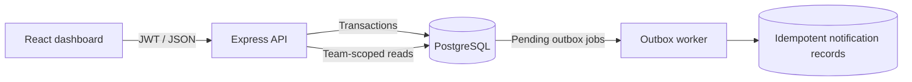

# Newtonite Ops — Operations Under Pressure

Newtonite Ops is an internal operations-management application for creating, assigning, tracking, discussing, and resolving team work items.

## Architecture

- **Web:** React 18 and Vite.
- **API:** Node.js 20+, Express 4, JWT authentication.
- **Persistence:** PostgreSQL 16 using parameterized SQL through `pg`.
- **Background work:** PostgreSQL transactional outbox with a worker in the API process.
- **Tests:** Node's test runner and Supertest; integration tests use PostgreSQL.
- **Local runtime:** Docker Compose.



## Requirements and startup

For the reproducible setup, install Docker Desktop with Docker Compose. From the project root:

```powershell
Copy-Item .env.example .env
docker compose up --build
```

Open the dashboard at <http://localhost:5173>. The API health endpoint is <http://localhost:4000/api/health>. The API waits for PostgreSQL's health check, applies the idempotent schema initialization and demo seed, then starts serving requests. The named `pgdata` volume persists database data between container restarts.

Stop the stack with `Ctrl+C`, or from another terminal run:

```powershell
docker compose down
```

`docker compose down` preserves the database volume. Do not use `docker compose down -v` unless you intentionally want to delete the local database and all its data.

### Environment

Root `.env.example` contains local-only placeholders for `POSTGRES_PASSWORD`, `JWT_SECRET`, `CLIENT_ORIGIN`, and `VITE_API_URL`. Replace the demo values for local use; use a long random JWT secret and a URL-safe PostgreSQL password. Never use these demo settings in a deployed environment. The Compose defaults are only convenient local demo defaults.

For a local Node/PostgreSQL setup without Docker, install Node.js 20+ and PostgreSQL 16+, create a database, copy `server/.env.example` to `server/.env`, and set `DATABASE_URL` and `JWT_SECRET`. Then run:

```powershell
npm install
npm run dev
```

The schema and seed are applied at API startup. For a local test run, start PostgreSQL and run `npm test -w server`; with the Compose stack running, use `docker compose exec server npm test`.

## Demo accounts

Every seeded account uses the local demo password **`password123`**. Passwords are stored as salted scrypt hashes.

| Account | Team(s) | Role(s) |
|---|---|---|
| `admin@demo.local` | Operations, Payments | Admin |
| `lead@demo.local` | Operations | Lead |
| `member@demo.local` | Operations | Member |
| `viewer@demo.local` | Operations | Viewer |
| `ops2@demo.local` | Operations | Member |
| `payments-lead@demo.local` | Payments | Lead |
| `payments-member@demo.local` | Payments | Member |
| `payments-viewer@demo.local` | Payments | Viewer |
| `payments2@demo.local` | Payments | Member |
| `dual@demo.local` | Operations, Payments | Member, Lead |

## Work item and authorization behavior

Items include title, description, type, priority, status, team, assignee, creator, due date, timestamps, and a monotonically incremented version. Types are incident, customer issue, payment, compliance, and task.

| Team role | Read team items/history/comments | Create, edit fields, claim, comment, move workflow | Reassign | Approve |
|---|---:|---:|---:|---:|
| Viewer | Yes | No | No | No |
| Member | Yes | Yes | No | No |
| Lead | Yes | Yes | Yes | Yes, for their team |
| Admin | Yes | Yes | Yes | No; approval is reserved to a Lead |

All permissions are enforced by the API. Item reads and writes are scoped to the user's team membership; inaccessible items return 404. Admin privileges are team-scoped, not global. Workflow is `Open → In Progress → Awaiting Approval → Resolved → Closed`, with the allowed `In Progress → Open` and `Awaiting Approval → In Progress` returns. Only a team Lead may approve `Awaiting Approval → Resolved`.

## API overview

All routes except health and login require `Authorization: Bearer <token>`.

| Method and route | Purpose |
|---|---|
| `GET /api/health` | API and PostgreSQL readiness |
| `POST /api/auth/login` | Sign in with a seeded account |
| `GET /api/me` | Current identity and team roles |
| `GET /api/dashboard` | Counts for assigned, urgent-unassigned, and Lead approval work |
| `GET /api/teams/:teamId/members` | Team-scoped member list |
| `GET /api/items` | Paginated items; filters: `q`, `status`, `priority`, `teamId`, `assigneeId`, `type`, and dashboard `view` |
| `POST /api/items` | Create; supports `Idempotency-Key` |
| `GET /api/items/:id` | Read one authorized item |
| `PATCH /api/items/:id` | Update fields; requires current integer `version` |
| `POST /api/items/:id/claim` | Atomically claim an unassigned item |
| `POST /api/items/:id/transition` | Request an allowed transition; requires `version` |
| `GET/POST /api/items/:id/comments` | Read or add comments |
| `GET /api/items/:id/activity` | Paginated item activity history |

List and history endpoints use bounded page/limit pagination (maximum limit 100); common team, status, priority, assignee, and activity lookups are indexed. The server returns 400 for invalid input, 401 for missing/invalid authentication, 403 for a forbidden team action, 404 for inaccessible/missing resources, and 409 for stale versions, conflicting claims, or reused idempotency keys with different payloads. Stale-version responses include the current authorized item where available.

## Concurrency, idempotency, history, and jobs

- Claiming is a single conditional PostgreSQL `UPDATE ... WHERE assignee_id IS NULL`; concurrent losing claims receive 409.
- Item edits and workflow changes compare the submitted version in the update predicate and atomically increment it.
- Create idempotency is scoped by user and operation. The stored SHA-256 request fingerprint prevents a key from being reused with another payload. The original status/body are saved with the item and returned on retry. Keys expire after seven days and expired rows are removed when a key is reused.
- Work-item changes, append-only activity events, and their outbox jobs are committed in one database transaction.
- The worker claims jobs with `FOR UPDATE SKIP LOCKED`, a 60-second lease, and bounded exponential retry delays (1 second to 5 minutes), up to five attempts. Exhausted jobs become `dead`. The demo notification handler is idempotent via a unique outbox-job reference.

## Tests

With the Compose database/API available:

```powershell
docker compose exec server npm test
```

Or with a local PostgreSQL database configured through `server/.env`:

```powershell
npm test -w server
```

The integration suite covers concurrent claims, stale-version protection, identical and conflicting idempotency retries, workflow validation and approval permissions, cross-team access, viewer write restrictions, atomic activity/outbox writes, outbox retry/dead-letter behavior and idempotent delivery, filtered pagination, authentication failures, and invalid input. Tests use the seeded PostgreSQL database and unique per-run test data.

Build the frontend with:

```powershell
npm run build -w client
```

## Known limitations and next steps

- This is a challenge/demo application, not a production identity system. There is no registration, password reset, SSO, MFA, rate limiting, or account lockout.
- Demo credentials and the Compose fallback secret are public by design and must be replaced before deployment. Production requires an externally configured `JWT_SECRET`.
- The notification handler writes a durable notification record for demonstration; it does not send email, push, or chat messages.
- The outbox worker runs in the API process. It is safe for multiple processes, but a dedicated worker deployment and operational monitoring would be preferable at higher scale.
- Pagination is offset-based; cursor pagination may be more efficient for very large or rapidly changing datasets.
- The initialization script is idempotent for this schema but is not a versioned migration framework.
- There is no production deployment configuration, attachment support, WebSocket update channel, or automated retention job for expired idempotency rows (expired records are cleaned when their key is reused).

With another week: introduce versioned migrations, add rate limiting and session revocation, move the worker into a separately scaled service with metrics/dead-letter operations, add cursor pagination, expand browser-level testing, and conduct deployment-specific security and accessibility reviews.
